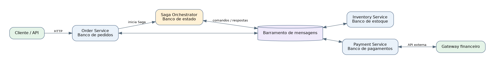
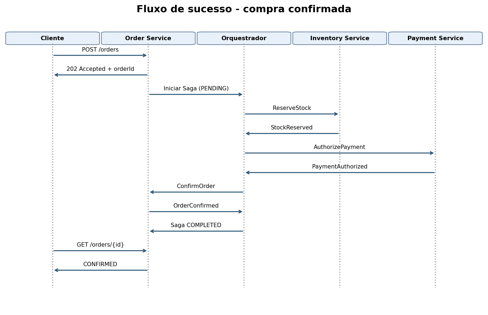
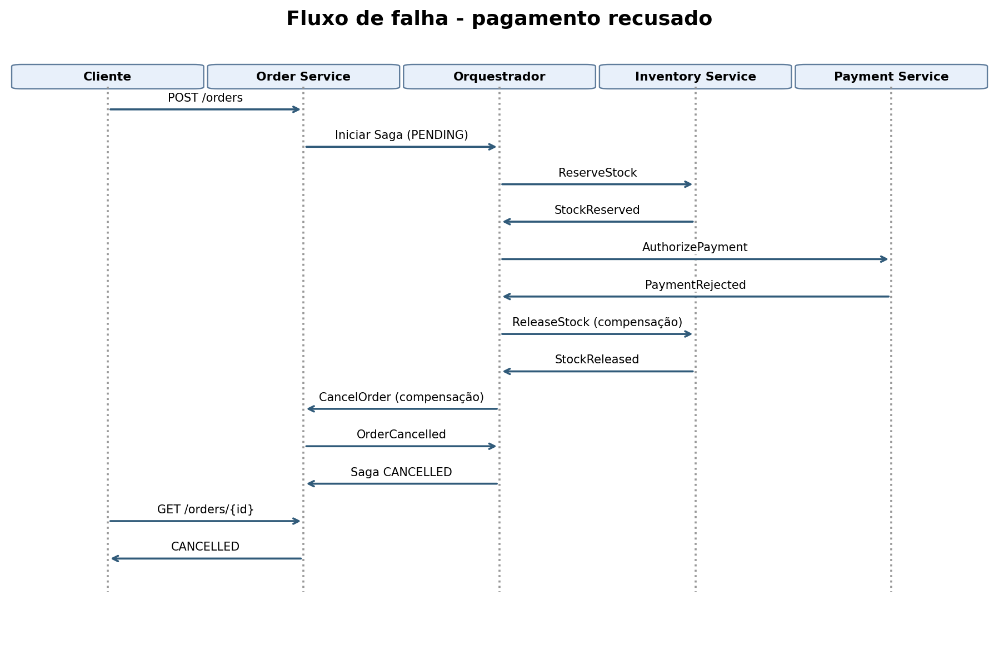

# Projeto de Arquitetura - Padrão Saga em um E-commerce

## Sobre o projeto

Neste trabalho a ideia é organizar o processo de compra de uma loja virtual que está saindo de um sistema monolítico para microsserviços. O problema é que cada serviço tem seu próprio banco de dados, então não dá para depender de uma transação única que desfaz tudo automaticamente quando alguma coisa falha.

Para resolver isso escolhi o padrão Saga, que divide a compra em operações menores. Quando alguma etapa dá errado, o sistema executa outras operações para compensar o que já tinha sido feito.

O cenário é uma proposta de arquitetura, não um sistema que foi implementado de verdade.

## Serviços utilizados

- Order Service: cria o pedido e atualiza sua situação.
- Inventory Service: reserva os produtos e devolve a reserva quando necessário.
- Payment Service: tenta autorizar o pagamento no gateway externo.
- Saga Orchestrator: acompanha cada etapa e decide qual comando enviar depois.

Cada serviço mantém seu próprio banco. A comunicação entre o orquestrador e os serviços acontece por comandos e respostas assíncronas através de um barramento de mensagens. A entrada do cliente é HTTP.

## Por que escolhi orquestração?

Existem duas opções principais, orquestração e coreografia. Na coreografia cada serviço reage aos eventos publicados pelos outros. Isso evita um coordenador central, mas pode ficar difícil entender o fluxo inteiro quando aparecem muitas regras e compensações.

Na orquestração existe um componente que controla as etapas da compra. Escolhi essa opção porque nesse exemplo é mais fácil saber quando reservar estoque, cobrar e cancelar um pedido. O ponto negativo é que o orquestrador vira uma parte importante do sistema e precisa ser persistente e escalável. Ele não deve guardar o estado só na memória.

## Como a compra funciona

O cliente envia uma requisição para criar o pedido. O Order Service registra o pedido como PENDING e inicia a Saga. Depois o orquestrador pede a reserva do estoque. Se der certo, solicita o pagamento. Quando o pagamento é autorizado, manda confirmar o pedido, que passa para CONFIRMED.

Se o pagamento for recusado, o orquestrador pede para liberar o estoque reservado e depois cancelar o pedido. O pedido termina em CANCELLED. Se a liberação falhar por um problema temporário, a Saga fica em compensação pendente até conseguir concluir ou receber atendimento operacional.

## Diagramas

### Visão geral

### Compra concluída

### Pagamento recusado e compensação

## Decisões técnicas

As regras de idempotência, os timeouts, os contratos de mensagens, a matriz de decisões e o tratamento de erros estão explicados em [decisoes-arquiteturais.md](docs/decisoes-arquiteturais.md).

## Conclusão

O principal aprendizado desse projeto é que usar microsserviços não significa que todas as operações vão acontecer ao mesmo tempo ou que tudo será revertido automaticamente. É preciso planejar o caminho normal e também o que fazer quando alguma etapa falha. A Saga ajuda nisso, mas depende de mensagens confiáveis, controle de estado e compensações bem definidas.

## Referência

Chris Richardson. [Pattern: Saga - Microservices.io](https://microservices.io/patterns/data/saga.html).
